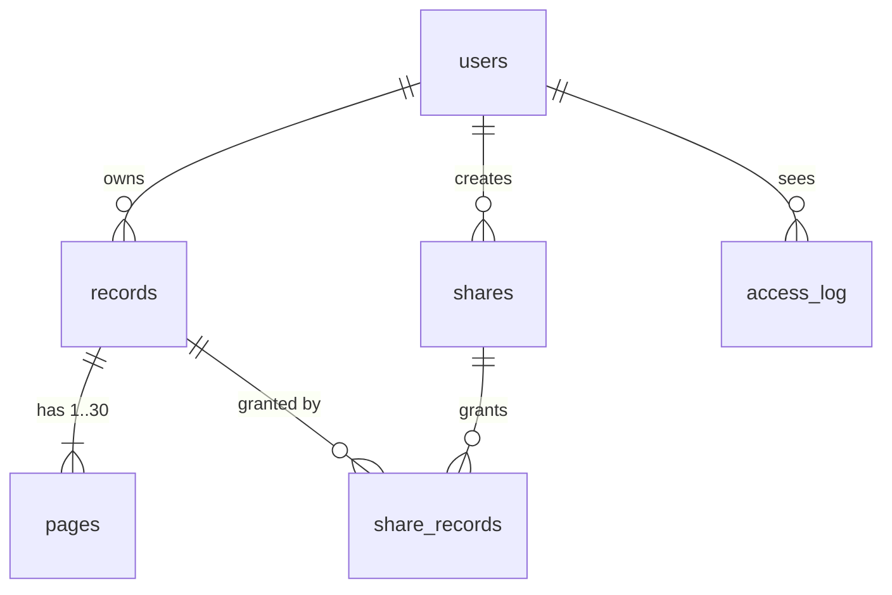
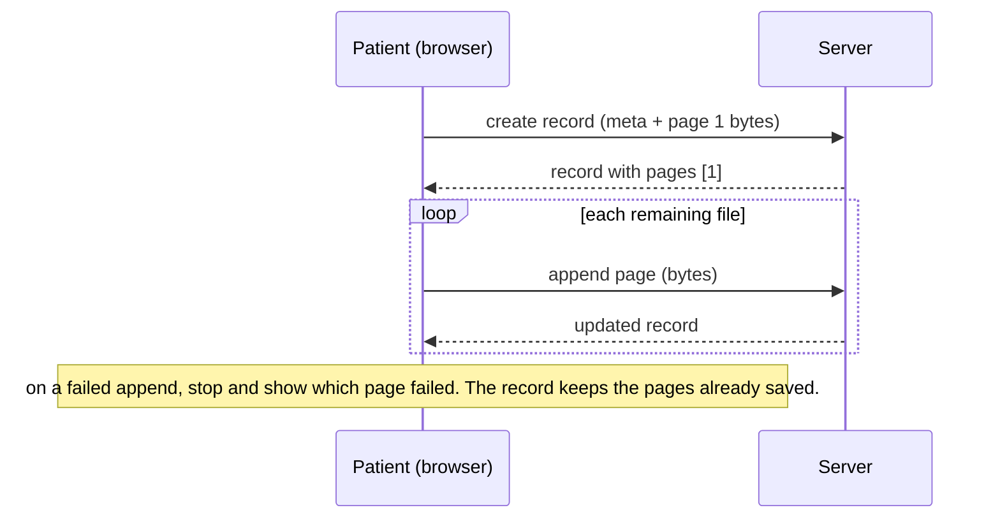

# MedVault Multi-page Records, Phone Capture and Full Export - Plan

## Goal Capsule

- **Objective:** A patient can turn a multi-page paper record into one digital record with their phone's camera, show every page to a doctor, and take a complete copy of their vault away, so they no longer carry the paper.
- **Means:** Extend the existing zero-dependency MedVault app in `medvault/` with records made of pages (KTD2), a streamed ZIP export (KTD4), and a password change. Do not rebuild it.
- **Authority:** Product Contract Requirements win on behavior. KTDs win on mechanism within those Requirements. Units override neither.
- **Stop conditions:** Stop and report if migrating existing records (R3) cannot keep every stored file decryptable, or if the built-in `node:sqlite` cannot drop the legacy columns (KTD3).
- **Execution profile:** Six units in dependency order, all in `medvault/`. API behavior is proven with `node:test`. UI behavior is proven with a browser walk-through.
- **Finishing:** `ce-work` implements, then the calling pipeline reviews and commits. The repository has no git remote, so shipping is a local commit.

---

## Product Contract

### Summary

MedVault already stores encrypted single-file records, a health summary and expiring doctor links. This work lets one record hold up to 30 pages. Pages can come straight from the phone camera or a multi-file pick. Doctors see every page through share links. Patients can download their whole vault as a ZIP that opens without MedVault. Patients can also change their password, which signs out their other devices.

### Problem Frame

Paper medical records are rarely one sheet: discharge summaries, lab panels and prescriptions run to several pages. Today MedVault accepts one file per record, so a patient has to scan to PDF elsewhere or split one document into unrelated records. Most patients don't scan at all, they photograph pages with a phone. The app also gives patients no way to get their data back out in bulk. That leaves the original problem, patients lacking their own copies, half solved. There is no password change either, which matters for an account holding health data.

### Requirements

**Capturing records**

- R1. A record holds 1 to 30 pages, each a PDF or image of at most 20 MB, kept in the order the patient added them.
- R2. On a phone, the patient can photograph pages directly from the add-record dialog and can also pick several files at once. Each picked or captured file becomes one page of the same record.
- R3. Records stored before this change keep their file, metadata, share-link membership and access history, and open as one-page records.
- R4. A patient can add pages to an existing record and delete a page. A record's last remaining page can't be deleted; deleting the record does that.

**Viewing and sharing**

- R5. The record viewer shows every page and moves between them, and the patient can download the current page.
- R6. A doctor opening a share link sees every page of each shared record, including pages added after the link was created. Opening or downloading a page is logged against that page's record in the patient's access history.

**Owning the data**

- R7. A signed-in patient can download one ZIP containing every page of every record plus a readable index of records and the health summary. It opens with the operating system's built-in archive tool, with no MedVault involved.

**Account security**

- R8. A signed-in patient can change their password by giving the current one. All of their other sessions end, and the current session stays signed in.

### Success Criteria

- A patient on a phone photographs a 3-page discharge summary, saves it as one record, and a doctor opening the share link can page through all 3 pages.
- An exported archive extracts with Windows Explorer's built-in ZIP support and with `tar -xf`, and every extracted file is byte-identical to its upload.

### Key Decisions

- **Pages added after sharing are visible through existing links.** A share grants a record, not a snapshot. Governs R6.

### Scope Boundaries

- Password reset by email is not built: MedVault has no mail service, and adding one is its own project.
- Client-side image compression is not built. The 20 MB per-page limit already fits phone photos (typically 2 to 8 MB). Reconsider if uploads on slow mobile networks prove too slow.
- Per-user storage quotas are not built. MedVault runs as a single-tenant demo where the operator is the user. Reconsider before hosting accounts for strangers.
- Purging expired session rows is not built. They are already ignored at lookup, and a single-tenant demo won't accumulate enough to matter. Reconsider before multi-user hosting.
- Reordering pages after upload is not built. Pages keep the order they were added in. Reconsider if patients report out-of-order scans.

#### Deferred to Follow-Up Work

- Family or dependent profiles: a parent or carer managing several people's records from one account.
- Offline access through a PWA cache of a patient's records on their own device.

---

## Planning Contract

### Key Technical Decisions

- KTD1. **All work stays inside the self-contained `medvault/` project**, on Node built-ins with no new dependencies. (session-settled: user-approved — chosen over building it inside `apps/web` or the pnpm workspace: it is an unrelated product.) The zero-dependency stack itself was an agent choice. It holds up for this work: ZIP needs only `zlib.crc32` (Node 22.2 and later; `engines` already requires 22.13), and nothing else here needs a library.
- KTD2. **A new `pages` table owns file storage; `records` keeps only metadata.** Each page row holds the record id, a position, the original file name, the sniffed MIME type, the size, and the AES-GCM IV and tag. Its ciphertext stays at `data/files/<page id>.bin`. The first page of every record, new or migrated, takes the record id as its page id, so `data/files/<record id>.bin` stays valid. Later pages get fresh UUIDs. One row per file fits R1 and R4 and keeps per-page encryption unchanged.
- KTD3. **Schema upgrades are versioned with `PRAGMA user_version` and run in one transaction at startup.** Version 0 to 1 creates `pages`, copies each record's file columns into a page at position 0 whose id equals the record id, and then drops those columns from `records`. Reusing the record id means no file on disk is renamed or re-encrypted, which is how R3 holds. Share links and access history key on record ids, so they need no migration.
- KTD4. **Export streams a ZIP using the "stored" method, with no compression, written one file at a time.** For each page, decrypt it, compute its CRC-32, write the local header and the bytes, then write the central directory at the end. Memory use stays at one decrypted page only if the loop waits for the response's `drain` event whenever a write returns false. PDFs and photos are already compressed, so deflate would add CPU for little gain. File names use the UTF-8 flag. ZIP64 is out of scope, so export refuses with a clear error before writing anything if the total would pass 4 GB. A failure after streaming has started destroys the connection instead of ending the response, so the browser reports a failed download. A cleanly ended response would hand the patient a truncated archive. Both rules exist so the patient never mistakes a corrupt archive for a backup (R7).
- KTD5. **The existing upload contract keeps working and pages are added one HTTP request each.** Creating a record still takes the first file as the raw body with metadata in `X-Record-Meta`. A new endpoint appends a page in the same shape. The UI uploads a multi-page record as one create plus N appends, showing progress. If an append fails, the record keeps the pages already stored and the dialog stays open with the unsent pages, so the patient can retry them. Camera captures exist only in the browser and can't be picked again. This avoids writing a multipart parser.
- KTD6. **Page files are addressed by page id under their record**, for both the owner and share routes. The record-level file routes are replaced, not kept as aliases, because the bundled UI is their only client.
- KTD7. **A password change deletes every session row for the user except the one making the request.**

### High-Level Technical Design

Data model after migration version 1:

Multi-page upload from the add-record dialog (KTD5):

### Assumptions

- The patient's phone browser honors `capture="environment"` on a file input (current iOS Safari and Android Chrome do). Elsewhere the same input falls back to an ordinary file picker, so R2 degrades to file upload without breaking.
- 30 pages per record is enough for real paper documents. Longer bundles can be split into several records.
- External research was not run. The design uses established mechanisms (SQLite schema versioning, the ZIP stored-entry format from the PKWARE APPNOTE, and OWASP password-change guidance to require the current password and end other sessions), and no external option set is open.

### Sequencing

U1, then U2, then U3, in order. U4 and U5 depend only on U1 and U2 and can follow in either order. U6 comes last.

---

## Implementation Units

### U1. Pages table and versioned migration

- **Goal:** Records store their files as ordered pages, and existing vaults upgrade in place on startup.
- **Requirements:** R1, R3. KTD2, KTD3.
- **Dependencies:** none.
- **Files:** `medvault/server.js`, `medvault/test/migration.test.js`.
- **Approach:**
  1. Move schema setup in `openDb` into a migration runner keyed on `PRAGMA user_version`. Version 0 is today's schema.
  2. Before running the version 1 step on a database that already has records, write a snapshot with `VACUUM INTO` to `data/medvault.pre-v1.db`, outside the migration transaction. The step drops the columns holding each file's IV and tag, so this snapshot is the recovery path if the copy is wrong.
  3. The version 1 step creates `pages` with an index on (record_id, position) and a cascade delete from records, copies the file columns into pages, and drops the five file columns from `records`. It runs in one transaction.
  4. A fresh database runs the same steps, so new and upgraded vaults end with the same schema.
  5. Point every query that read file columns from `records` (`publicRecord`, `sendFile`, `deleteRecord`, `DELETE /api/me`) at `pages`. `publicRecord` returns a `pages` array of id, file name, MIME type and size in position order.
- **Patterns to follow:** prepared statements in the `q` object. `BEGIN`/`COMMIT`/`ROLLBACK` as `POST /api/shares` already does.
- **Test scenarios:**
  - Build a version 0 database in a temp dir with one record, one encrypted file on disk and a share granting it. Starting the server migrates it: the record lists one page whose id equals the record id, the owner download returns the original bytes, and the existing share link still serves the page.
  - Starting the server a second time against a migrated database is a no-op. `user_version` stays 1 and the page count is unchanged.
  - A fresh data dir reaches `user_version` 1 with an empty `pages` table, and the five legacy file columns are absent from `records`.
  - Migrating a version 0 database with records writes `data/medvault.pre-v1.db`, which still has the legacy file columns. A fresh data dir writes no snapshot.
  - Deleting a record removes its page rows and every `files/<page id>.bin`.
- **Verification:** the migration tests pass. Existing `test/api.test.js` assertions that read the record-level `mime` now read `record.pages[0]`. Disk-path assertions on `files/<record id>.bin` hold unchanged under KTD2. File-route paths change with U2.

### U2. Page endpoints for owners and share links

- **Goal:** Owners can append, fetch and delete pages, and share-link holders can fetch every page of a shared record.
- **Requirements:** R1, R4, R6. Key Decision on sharing, KTD5, KTD6.
- **Dependencies:** U1.
- **Files:** `medvault/server.js`, `medvault/test/api.test.js`.
- **Approach:**
  1. Add an append-page route. It takes the raw body plus the original file name in a base64url `X-Page-Meta` header, uses the same MIME sniffing and size limit as record creation, and returns the updated record.
  2. Reject an append once the record has 30 pages, with 409 and a clear message.
  3. Add a delete-page route. It removes the row and the ciphertext and refuses with 409 when the page is the record's last.
  4. Add page file routes for owners and share links, with `?download=1` support. Every owner page route (file, download, delete) loads the page only when the page belongs to the record in the path and that record belongs to the signed-in user, and returns 404 otherwise. The share route checks that the page belongs to a record granted by that share. Page ids reach doctors through share responses, so neither check can rest on the record id alone. Access-log entries keep recording the record id, so the history stays readable per R6.
  5. Remove the record-level file routes (KTD6).
- **Patterns to follow:** `liveShare`, `sendFile` and the `route()` table in `medvault/server.js`.
- **Test scenarios:**
  - Appending a PNG to a one-page PDF record returns two pages in order, and each page's file route returns its original bytes.
  - Appending a 31st page returns 409, and the record still has 30 pages.
  - Appending a text file returns 415 and stores nothing.
  - Deleting the second of two pages leaves one. Deleting the last page returns 409.
  - Another user appending to, deleting from, or fetching a page of someone else's record gets 404.
  - User B calls the page file, download and delete routes with B's own record id and user A's page id and gets 404 each time, and A's page is unchanged.
  - A share created before a page was appended serves the new page to the doctor (Key Decision on sharing).
  - A share link cannot fetch a page of a record it does not grant, even with a valid page id: 404.
  - A doctor viewing page 2 adds a "Viewed record" access-log entry naming that record.
- **Verification:** all API tests pass, and no route reads the dropped `records` file columns.

### U3. Multi-page capture, upload progress and page viewer

- **Goal:** Patients can photograph or pick several pages into one record and page through records as owner or doctor.
- **Requirements:** R2, R4, R5, R6. KTD5.
- **Dependencies:** U2.
- **Files:** `medvault/public/index.html`, `medvault/public/app.js`, `medvault/public/share.html`, `medvault/public/share.js`, `medvault/public/styles.css`.
- **Approach:**
  1. In the add-record dialog, the file input accepts `multiple`, and a separate "Take photo" control uses `capture="environment"`. Each capture or pick appends to an ordered list of pending pages, each shown with its page number and a remove control. Drag-and-drop accepts several files.
  2. Validate on selection, before anything is uploaded. A file that isn't a PDF or image, or is over 20 MB, is rejected with an inline message naming it. Selection stops at the R1 page limit with a message.
  3. Saving uploads the first page through the create call, then appends the rest. The button shows "Uploading page n of N". If an append fails, the dialog stays open showing an inline error. The failed and unsent pages stay listed, with a "Retry remaining pages" action that appends them to the record already created (KTD5).
  4. The viewer shows a page indicator and previous/next controls, and download targets the current page. The owner viewer adds "Add page" (reusing the picker) and "Delete page", which is disabled when only one page remains.
  5. Record cards show the page count. The share page viewer gets the same page navigation without the edit controls.
- **Patterns to follow:** the `el()` helper and dialog handling in `medvault/public/app.js`. Keep vanilla JS with no build step (KTD1).
- **Execution note:** Prove this unit with a browser walk-through against the running server, not unit tests. There is no front-end test harness, and adding one would break KTD1.
- **Test scenarios:**
  - Picking three images in one go and saving creates one record whose viewer shows "1 / 3" and moves to pages 2 and 3.
  - Removing one pending page before saving uploads only the remaining pages, in order.
  - Picking a `.txt` file or a 25 MB image shows an inline rejection naming it, and it never joins the pending list.
  - When the server is stopped after page 1 of 3 is saved, the dialog stays open listing pages 2 and 3. Restarting the server and choosing "Retry remaining pages" completes the record with 3 pages.
  - Adding a page from the viewer brings the count to 4 without leaving the viewer.
  - Delete page is disabled on a one-page record.
  - A doctor opening a share link for that record can page through all pages, and each page view appears in the owner's access history.
  - At a 375 px viewport the dialog, page controls and record cards fit with no horizontal page scroll.
- **Verification:** the walk-through above passes in the browser with no console errors.

### U4. Full-vault ZIP export

- **Goal:** A patient downloads every page and their health summary in one archive that opens without MedVault.
- **Requirements:** R7. KTD4.
- **Dependencies:** U1.
- **Files:** `medvault/server.js`, `medvault/public/index.html`, `medvault/public/app.js`, `medvault/test/export.test.js`.
- **Approach:**
  1. Add an authenticated export route. Before writing anything, sum the page sizes and return 413 if the total passes the ZIP limit, and check that every page's ciphertext file exists (KTD4). After streaming starts, any failure destroys the response (KTD4).
  2. Each record becomes a folder named `<record date> <sanitized title>` (made unique on collision), holding `page-<n>.<ext>` files.
  3. A top-level `index.html` lists records by date with type, provider, notes and links to each page, plus the health summary. The index is static HTML with no scripts, and every value is escaped.
  4. Stream with `Content-Disposition: attachment` and a dated file name. Add a "Download all my records" button on the Account page.
- **Technical design:** directional only. For each page: decrypt, take its CRC-32, write the local file header (stored, UTF-8 flag) and the bytes, and remember the offset. Whenever a write returns false, wait for `drain` before decrypting the next page (KTD4). Then write the central directory entries and the end-of-central-directory record.
- **Test scenarios:**
  - Export for a user with two records (one with two pages) yields a ZIP whose central directory lists `index.html` plus three page files, each with a CRC-32 matching the original upload.
  - The archive extracts with the system `tar -xf`, and the extracted bytes equal the uploads.
  - A title containing `/`, `..` or `<script>` becomes a safe folder name, and is escaped text in `index.html`.
  - A user with no records gets a valid ZIP containing only `index.html`.
  - A page whose ciphertext file is corrupted after the pre-flight check makes the client see an aborted transfer, not a complete 200 response. One example is a GCM tag that fails to verify.
  - An unauthenticated request gets 401.
- **Verification:** the export tests pass, and a manual export from the Account page opens in the OS archive viewer.

### U5. Change password and sign out other sessions

- **Goal:** A patient can rotate their password, and any other device signed in to their account is signed out.
- **Requirements:** R8. KTD7.
- **Dependencies:** none (independent of U1 to U4).
- **Files:** `medvault/server.js`, `medvault/public/index.html`, `medvault/public/app.js`, `medvault/test/api.test.js`.
- **Approach:**
  1. Add an authenticated password route taking the current and new password. It uses the same 8-character minimum as registration and the same login throttle.
  2. On success, update the hash and salt and delete the user's other session rows.
  3. Add a "Change password" form on the Account page.
- **Test scenarios:**
  - Changing the password with the correct current password returns 200. The old password then fails login and the new one succeeds.
  - A second session signed in before the change gets 401 afterwards, while the session that made the change still works.
  - A wrong current password returns 401 and leaves the password unchanged.
  - A new password shorter than 8 characters returns 400.
- **Verification:** API tests pass, and the Account page form works in the browser.

### U6. README and launch notes

- **Goal:** The README describes multi-page records, phone capture, export and password change, and notes that existing data upgrades automatically.
- **Requirements:** R1 to R8 (documentation only).
- **Dependencies:** U1 to U5.
- **Files:** `medvault/README.md`.
- **Approach:** Update the feature list and add a short "Upgrading" note. It should say the first start after this change migrates the database, and that `data/` should be backed up first.
- **Test expectation:** none, documentation only.
- **Verification:** the README matches the shipped behavior.

---

## Verification Contract

| Gate | Command or method | Proves |
|---|---|---|
| API and migration tests | `npm test` run inside `medvault/` | U1, U2, U4, U5 behavior, including the migration from version 0 |
| Browser walk-through | `npm start` inside `medvault/`, then the U3 scenarios at desktop and 375 px widths | R2, R4, R5, R6 in the real UI |
| Export interoperability | extract a downloaded export with `tar -xf` | R7 |

---

## Definition of Done

- Every Requirement R1 to R8 is met and traced to a passing test or a recorded browser walk-through step.
- `npm test` inside `medvault/` passes with the new migration and export tests.
- A vault created before this change (an old-schema `data/` directory) opens after the upgrade with every record readable.
- No server code reads the dropped `records` file columns. Every file read goes through `pages`.
- No new runtime dependencies are added, and `medvault/package.json` still has no `dependencies` key.
- Code from abandoned approaches is removed from the diff, and nothing outside `medvault/` changes except this plan.
